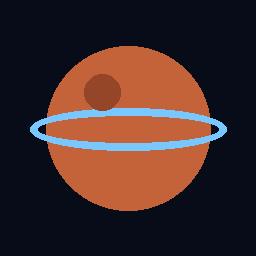

<p align="center"></p>

<h1 align="center">Next Frontier Explorer</h1>

<p align="center">
Design a space mission, fly it, land it, then drive across terrain built from real NASA data.<br>
Made for the <b>NASA Space Apps Challenge 2026</b>: Space Mission Design Game.
</p>

<p align="center">
<a href="https://mozaix.github.io/NASA/"><b>▶ Play in your browser</b></a>
· <a href="https://github.com/Mozaix/NASA/releases/latest"><b>⬇ Download for macOS, Windows or Linux</b></a> (works fully offline)
</p>

---

## What it is

Next Frontier Explorer turns real mission planning into a game. You choose a destination, from the Moon and Mars to the moons of Jupiter and Saturn and even exoplanets. Then you pick a rocket and instruments within a budget, wait for the right launch window and fly the whole mission yourself:

**Plan → Launch → Cruise → Orbit → Land → Load the power core → Explore → Debrief**

Every number in the game comes from NASA data: planet facts, orbits from JPL, exoplanets from the NASA Exoplanet Archive, and terrain from MOLA (Mars) and LOLA (Moon) elevation maps. Values the game calculates itself are labelled *derived*. Facts on screen are direct quotes from NASA pages, each with its source.

### Game modes

| Mode | What you do |
|---|---|
| **Play Main Game** | The full mission, from the planning table to driving a rover across a real crater. |
| **Play Demo** | A guided run of about 4 minutes, with a 3-question quiz before and after to show what you learned. |
| **Play 2D** | Build rockets from parts, earn money from altitude, buy better parts and climb the daily leaderboard. |

### New in v2.0
- **Debris dodge**: twice on the way to your target, meteoroids or space debris rush at your spacecraft, seen from on top of it. Answer a question before the timer runs out to fire the thrusters. Questions use your own mission's NASA numbers (gravity, travel time, moons) plus real debris science, and every answer is explained.
- **Classroom mode**: in **Results**, a teacher names a class before the lesson. Quiz results and debris answers are kept per class, with no player names. Includes before/after charts, the hardest questions, a CSV export and a printable lesson sheet with a 40-minute plan and answers.
- **Play in a browser**: no install needed, on school Chromebooks too. It uses a lighter renderer, so it looks a little simpler, and the first load is about 160 MB.
- **Presenter mode**: press **F2** while pitching for a 3-minute timer and talking points for each screen. Press F2 again for the timer only.

<details>
<summary>v1.9</summary>

- **3D launch site**: the Bahrain spaceport is now a full 3D place. The ground is built from NASA SRTM heights (raised ×5, because Bahrain is nearly flat) and draped with NASA/USGS Landsat imagery.
- **A real launch pad**: a raised concrete pad with a flame trench and launch mount, a service tower with swinging access arms, lightning masts, a water tower, propellant tanks, a hangar and roads
- **T-minus countdown**: go for launch, then watch the terminal count from T-30. The arms retract, the vents steam, the water deluge starts and the engines light at T-3, with liftoff at T-0. Press Space again to skip to T-10.

</details>

<details>
<summary>Earlier versions</summary>

- **v1.8**: launch from a concept spaceport in Bahrain; how-to-play popups on every screen; fixes for reverse driving and fuel use
- **v1.7**: fixed the Mars orbit screen hiding the *Begin descent* button
- **v1.6**: learning results screen, pitch deck and showcase video
- **v1.5**: parachute physics and tearing; derelict landers with a salvage mini-game
- **v1.4**: power-core loading mini-game after touchdown
</details>

## How to play

### Play in a browser

Open **https://mozaix.github.io/NASA/** in Chrome, Edge or Firefox on a laptop or Chromebook. The first load is about 160 MB; after that the browser keeps it. Results and classes are saved in that browser.

### Install

Or download the file for your computer from the [latest release](https://github.com/Mozaix/NASA/releases/latest).

> **Note:** don't use GitHub's green *Code → Download ZIP* button to get the game. The builds are stored with Git LFS, so that ZIP holds small placeholder files instead of the game.

**macOS** (Apple Silicon or Intel)
1. Unzip `NextFrontierExplorer-macOS.zip` and drag the app to your Desktop.
2. The first time only: **right-click** the app, choose **Open**, then click **Open** again. The app isn't signed by Apple.
3. If you only see *Done*, go to **System Settings → Privacy & Security** and click **Open Anyway**.
   If macOS says the app is damaged, run `xattr -cr ~/Desktop/NextFrontierExplorer.app` in Terminal.

**Windows** 10 or 11 (64-bit)
1. Unzip the download, keeping `NextFrontierExplorer.exe` and `NextFrontierExplorer.pck` together.
2. Run the `.exe`. If SmartScreen warns you, click **More info → Run anyway**.

**Linux** (64-bit)
```bash
chmod +x NextFrontierExplorer.x86_64
./NextFrontierExplorer.x86_64   # keep the .pck file next to it
```

### Controls

Keyboard and mouse, or any standard gamepad (plug it in before starting). You can change keys in **Settings**.

| Action | Keyboard | Gamepad |
|---|---|---|
| Drive, steer, throttle | `W` `A` `S` `D` | Left stick |
| Look around | Mouse or arrow keys | Right stick |
| Main action (ignite, burn, jump) | `Space` | A |
| Collect sample, scan (hold) | `E` | X |
| Boost | `Shift` | Right bumper |
| Spin tricks (hold) | `Q` + `W` `A` `S` `D` | Left trigger |
| Headlights | `L` | Y |
| Map / scale toggle | `M` | Back |
| Autopilot | `P` | Left bumper |
| Look down at the pad | `C` | Right stick press |
| Show exact numbers | `Tab` | D-pad up |
| Pause | `Esc` | Start |
| Answer a debris question | `1` `2` `3` or click | — |
| Presenter mode (timer and notes) | `F2` (`F3` restarts the timer) | — |

### Tips
- **Launch:** press `Space` to go for launch and start the T-minus countdown. After liftoff, keep the stress needle out of the red, and steer into crosswinds with `A` / `D`.
- **Landing:** touch down slowly and upright. `C` looks straight down at the pad, and `P` hands control to the autopilot.
- **Surface:** rocks damage the rover. Drive back to the lander to repair, or salvage parts from derelict landers.
- **Slow computer?** Set Graphics to **Low** in Settings.

## Running from source

1. Install **[Godot 4.7](https://godotengine.org/download)** (standard build, not .NET).
2. Clone the repo with Git LFS (needed only for the ready-made builds in `USB_BUILD/`):
   ```bash
   git lfs install
   git clone https://github.com/Mozaix/NASA.git
   ```
3. Open `project.godot` in Godot and press **F5**, or run `godot --path .`.

| Task | Command |
|---|---|
| Run the test suite | `tools/run_tests.sh` |
| Build macOS, Windows and Linux into `USB_BUILD/` | `tools/export_all.sh` |
| Re-download and process the NASA data | `pip install -r tools/requirements.txt && python3 tools/fetch_data.py` |

### Project layout

```
autoload/   Global systems: data, orbital physics, game state, settings, sound, scene flow, tips
scenes/     One script per screen: menu, planner, launch, transfer, orbit, landing, hatch, surface, debrief…
scripts/    Shared pieces: GPU terrain, rover, salvage mini-game, UI kit, models
shaders/    Terrain, planets, atmosphere, rings, sky
data/       Bundled NASA data and SOURCES.md (the game never goes online)
tests/      Headless test suite
tools/      Data pipeline, export and test scripts
pitch/      Pitch deck and showcase video
USB_BUILD/  Ready-to-run builds (Git LFS)
```

## Data and credits

Every dataset is listed in [`data/SOURCES.md`](data/SOURCES.md) and on the in-game **Credits** screen. Highlights:
NASA Solar System Treks · NASA Planetary Fact Sheet · NASA Exoplanet Archive · JPL Keplerian elements · MOLA MEGDR and LOLA LDEM (PDS Geosciences Node) · NASA SVS Deep Star Maps · SRTM and Landsat (NASA/USGS).

This is a fan project made for the NASA Space Apps Challenge. **It is not endorsed by NASA.** NASA data and imagery are used under [NASA's media usage guidelines](https://www.nasa.gov/nasa-brand-center/images-and-media/). Built with [Godot Engine](https://godotengine.org) (MIT licence).
